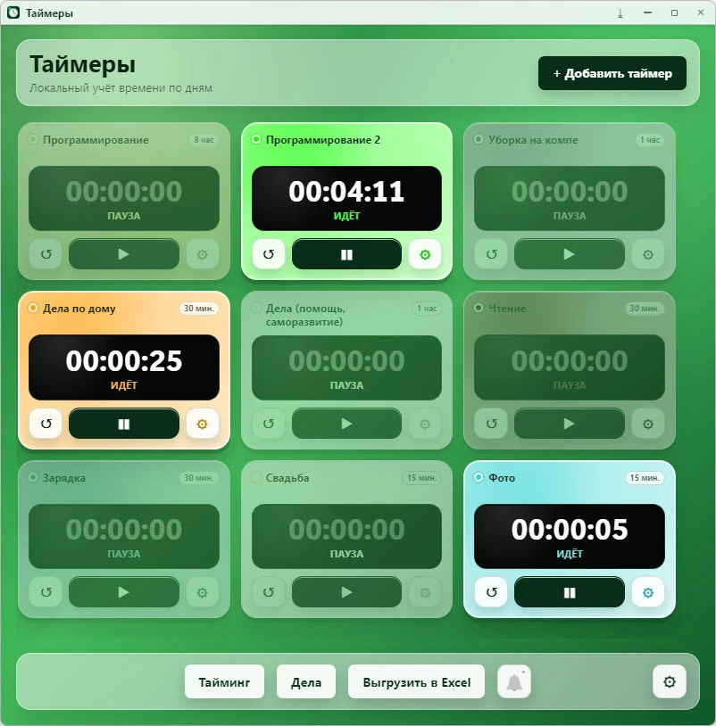

# Таймеры - учёт времени и задач

**Автор проекта:** [Евгений Толмачев](https://github.com/EvgenyET) · [Страница проекта в портфолио](https://evgeny-dev.pro/project.html?id=Timer)

Несколько независимых секундомеров с названиями и цветами, дневная статистика, задачи и будильники. Локальное сохранение данных и экспорт в Excel.

## Мой вклад

Сделал приложение для одновременного учёта нескольких занятий. Реализовал независимый запуск и паузу таймеров, привязал интервалы к дням и добавил графики, на которых можно сравнить распределение времени.

## Интерфейс

| Независимые таймеры на главном экране | Распределение времени по занятиям |
|:---:|:---:|
|  |  |

## Как это работает

Приложение помогает учитывать время по нескольким занятиям и смотреть историю по дням. Каждый таймер имеет отдельные настройки. Состояние, комментарии и статистика сохраняются локально. Для повседневной работы предусмотрены будильники, сворачивание в трей, резервные копии и выгрузка отчёта.

## Возможности

- Запуск, пауза и сброс отдельных таймеров с пользовательскими названиями, цветами и плановой длительностью.
- Дневная статистика времени с комментариями и отдельным списком дел.
- Ежедневные будильники с выбором мелодии и отсрочкой сигнала.
- Локальное сохранение состояния, резервные копии и восстановление выбранной копии.
- Экспорт статистики и дел в Excel, работа в системном трее.

## Технологии

- **Electron** - Настольное окно, системный трей, диалоги файлов и IPC.
- **JavaScript** - Логика таймеров, будильников, статистики и интерфейса.
- **Node.js** - Чтение и запись локальных данных, резервных копий и отчётов.
- **JSON** - Хранение состояния, истории времени и пользовательских настроек.
- **Excel XML** - Экспорт таблиц статистики и задач в файл .xls.

## О проекте

Приложение для учёта времени по занятиям и задачам. Оно объединяет независимые таймеры, историю по дням и напоминания. Данные остаются в локальном хранилище и доступны для резервного копирования.

Коммерческий проект. Исходный код закрыт.
