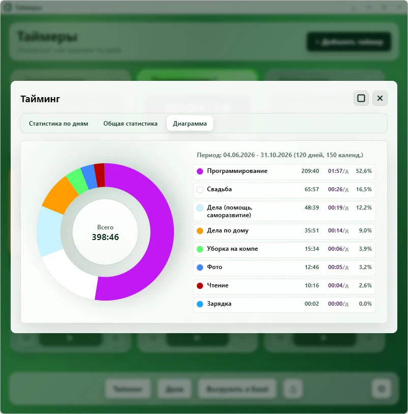

# Таймеры - учёт времени и задач

Автор проекта - **Евгений Толмачев**. [Профиль GitHub](https://github.com/EvgenyET) · [Проект в портфолио](https://evgeny-dev.pro/project.html?id=Timer)

Приложение для учёта времени по задачам. Независимые секундомеры, история по дням, графики, будильники, резервные копии и экспорт статистики в Excel.

## Задача проекта

Локальный инструмент для повседневного учёта занятий. Важная часть реализации - сохранить корректную историю интервалов и рабочее состояние при закрытии окна и переходе между днями. Хранение, расчёт времени и напоминания сосредоточены в основном процессе Electron.

## Мой вклад

Разработал независимые таймеры, обработку запусков, пауз и сбросов, дневную историю и статистику. Добавил задачи, будильники с выбором мелодии и отсрочкой, работу в трее. Реализовал локальное хранение с атомарной заменой файла, резервные копии и экспорт данных времени и дел в Excel.

## Интерфейс

| Независимые таймеры на главном экране | Распределение времени по занятиям |
|:---:|:---:|
|  |  |

## Как работает приложение

Timer позволяет учитывать время нескольких занятий в одном настольном окне. Для каждой задачи можно задать название, цвет и плановую длительность, затем независимо запускать и приостанавливать секундомер. Приложение распределяет интервалы по дням и собирает статистику для просмотра на графиках. Рядом доступны список дел и будильники, а историю можно экспортировать в Excel или восстановить из резервной копии.

## Возможности

- Запуск, пауза и сброс отдельных таймеров с пользовательскими названиями, цветами и плановой длительностью.
- Дневная статистика времени с комментариями и отдельным списком дел.
- Ежедневные будильники с выбором мелодии и отсрочкой сигнала.
- Локальное сохранение состояния, резервные копии и восстановление выбранной копии.
- Экспорт статистики и дел в Excel, работа в системном трее.

## Техническое устройство

### Состояние и учёт времени

Основной процесс Electron хранит состояния таймеров, фиксирует интервалы и распределяет время по датам. Здесь же проверяются будильники и плановая длительность.

### Интерфейс

Renderer показывает таймеры, настройки, дневную статистику и задачи. Узкий API в preload передаёт команды основному процессу и возвращает актуальное состояние.

### Надёжное хранение и экспорт

Данные записываются в локальный JSON с атомарной заменой файла. Приложение управляет резервными копиями и формирует Excel XML с листами времени и задач.

## Технологии

| Технология | Роль в проекте |
| --- | --- |
| Electron | Настольное окно, системный трей, диалоги файлов и IPC. |
| JavaScript | Логика таймеров, будильников, статистики и интерфейса. |
| Node.js | Чтение и запись локальных данных, резервных копий и отчётов. |
| JSON | Хранение состояния, истории времени и пользовательских настроек. |
| Excel XML | Экспорт таблиц статистики и задач в файл .xls. |

## Состояние показанной версии

- Данные хранятся локально, синхронизация между устройствами в рассмотренной версии не предусмотрена.

## Демонстрация

На странице портфолио доступны описание, галерея и видеодемонстрация проекта. [Открыть Таймеры - учёт времени и задач](https://evgeny-dev.pro/project.html?id=Timer).
